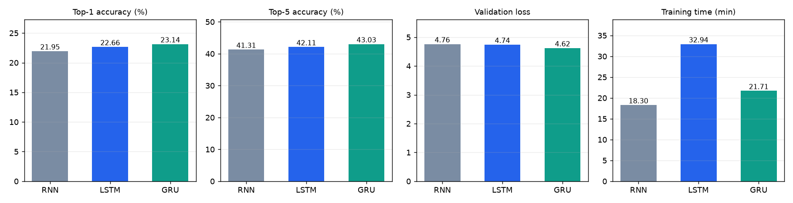
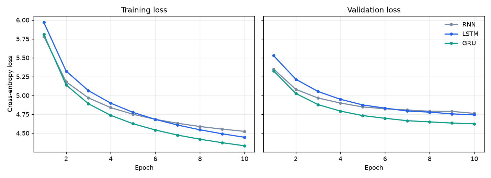
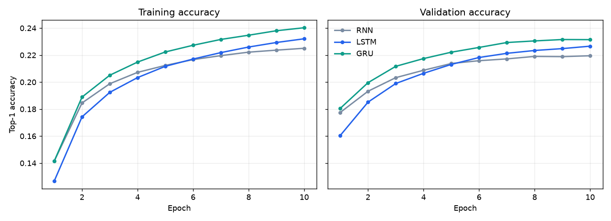

<div align="center">
<br>


<br>

[](#)
[](#)
[](#)
[](#)

<br>


</div>

<br>

<!--
DEMO: record a short screen capture of typing + pressing Tab, save it as docs/demo.gif and uncomment:

<div align="center">

</div>
-->

## 🎯 About This Project

> Your phone keyboard guesses your next word. How does it know? This project answers that by building the idea from scratch: a web editor that predicts the next word **while you type**, powered by neural networks that were trained on Deep Learning text.

You type, a short pause later suggestions appear below the editor and as highlighted ghost text right after your cursor. Press **Tab** (or click a word) to accept it, and the next prediction starts immediately. You can switch between **SimpleRNN, LSTM and GRU** while you type and see how each model thinks.

Every suggestion is a real forward pass of the selected trained network. Nothing is hard-coded, mocked or simulated, and every number in this README was measured in the actual training run.

<div align="center">

```
░░░░░░░░░░░░░░░░░░░░░░░░░░░░░░░░░░░░░░░░░░░░░░░░░░░░░░░░░░░
   Open-licensed docs → Clean → De-duplicate → Split by document
   ───────────────────────────────────────────────────────────
   SimpleRNN  ·  LSTM  ·  GRU   (same data, same settings)
   ───────────────────────────────────────────────────────────
   Flask API (models loaded once) → live suggestions in the browser
░░░░░░░░░░░░░░░░░░░░░░░░░░░░░░░░░░░░░░░░░░░░░░░░░░░░░░░░░░░
```

</div>

<br>

---

## ✨ What Makes This Project Stand Out

<table>
<tr>
<td width="50%" valign="top">

### ⌨️ Autocomplete That Feels Live
- No Predict button, ever: predictions fire after a short typing pause (180 ms debounce)
- Top 3 to 5 suggestions as clickable chips with model probabilities
- Best suggestion also appears as **inline ghost text**; **Tab** accepts it
- Unfinished words are completed (`desc` → `descent`)
- Slow, out-of-date responses are cancelled and ignored

</td>
<td width="50%" valign="top">

### 🧠 Three Real Models, One Fair Setup
- SimpleRNN, LSTM and GRU share the same data, vocabulary, split and settings
- Switch models mid-sentence with no page reload
- Models and tokenizer load **once** at server start; the website never trains
- Special tokens, padding and punctuation can never be suggested

</td>
</tr>
<tr>
<td width="50%" valign="top">

### 📚 A Corpus I Collected and Measured
- 6 open-licensed documentation sources, downloaded by script
- Code, tables, links and boilerplate removed; duplicates dropped
- Sources and licences recorded in `data/SOURCES.md`
- Easy to extend: add repos, Wikipedia titles or your own `.txt` files

</td>
<td width="50%" valign="top">

### 📊 Honest Evaluation
- Split by **whole documents** before windowing, so overlapping text cannot leak into validation
- Vocabulary built from training documents only
- A no-context baseline shows what "learning" really means here
- Limitations are stated, not hidden (see below)

</td>
</tr>
</table>

<br>

---

## 🗺️ Full Project Journey

<div align="center">

| Step | Focus | Key Output |
|:---:|:---|:---|
| 📥 **1** | Dataset collection | 840 raw documents · 1,111,296 words from 6 open sources |
| 🧹 **2** | Cleaning and statistics | 813 documents · 941,283 words · vocabulary 8,964 · 793,074 training sequences |
| 🏋️ **3** | Training | SimpleRNN, LSTM, GRU · early stopping · best-epoch checkpoints |
| 📈 **4** | Evaluation | Same validation set for all models · baseline · curves and comparison charts |
| 🌐 **5** | Web application | Flask API + live autocomplete + evaluation dashboard |
| ✅ **6** | Testing | 31-check smoke test (models + API) · 27-check UI behaviour test |

</div>

<br>

---

## 📚 The Dataset

<div align="center">

| Source | What it contains | Licence | Documents | Words |
|:---|:---|:---:|---:|---:|
| Dive into Deep Learning | Free textbook: RNN/LSTM/GRU, attention, CNNs, optimisation | CC BY-SA 4.0 | 168 | 257,464 |
| Keras guides and examples | Keras documentation and tutorials | Apache-2.0 | 255 | 223,623 |
| TensorFlow tutorials and guides | TensorFlow documentation | Apache-2.0 | 127 | 179,938 |
| PyTorch tutorials | PyTorch documentation | BSD-3-Clause | 168 | 165,416 |
| Hugging Face course | NLP, transformers and LLM lessons | Apache-2.0 | 94 | 109,643 |
| LLM course (mlabonne) | Guide to large language models | Apache-2.0 | 1 | 5,199 |
| **Total after cleaning** | | | **813** | **941,283** |

</div>

| Measured quantity | Value |
|:---|---:|
| Raw documents / words / characters | 840 / 1,111,296 / 7,437,209 |
| Clean documents / words / characters | 813 / 941,283 / 5,932,172 |
| Distinct words in corpus | 20,101 |
| **Model vocabulary size** (min count 3) | **8,964** |
| Train / validation documents | 720 / 93 |
| **Training sequences** (context of 12 tokens) | **793,074** |
| **Validation sequences** | **90,445** |

**Cleaning steps:** code blocks, tables, URLs and boilerplate are removed; maths becomes a `<math>` placeholder, inline code becomes `<code>`, numbers become `<num>`; 5,734 duplicate paragraphs and 404 boilerplate paragraphs were dropped, along with very short, repetitive or mostly-math paragraphs.

> ⚠️ **Wikipedia support is built in but was not part of this run.** The downloader can add ~80 Deep Learning articles (CC BY-SA 4.0), but it was never executed in the build environment, which blocked that site. The corpus used for the results below is documentation and tutorial text only. Run `python download_dataset.py` on your machine to include Wikipedia.

<br>

---

## 🛠️ Pipeline

<div align="center">

```
download_dataset.py   GitHub docs (+ Wikipedia)  →  data/raw/*.txt  +  manifest (sources, licences)
        ↓
preprocess.py         clean · de-duplicate · split by DOCUMENT · vocabulary (train only) · windows
        ↓
train.py              SimpleRNN · LSTM · GRU  →  models/*.keras · tokenizer.json · config.json
        ↓
evaluate.py           same validation set · baseline · curves · outputs/metrics.json
        ↓
app.py + predict.py   Flask API, models loaded once  →  static/app.js live autocomplete
```

</div>

**Model (identical for all three, only the recurrent cell changes):**

```
Embedding(96) → Dropout(0.15) → [SimpleRNN | LSTM | GRU](128 units) → Dropout(0.3) → Dense(8,964, softmax)
```

Adam (lr 0.001, gradient clipping 1.0), ReduceLROnPlateau, early stopping (patience 2), best-epoch checkpointing, batch size 256, up to 8 epochs, and a **26-minute training cap per model** on a single CPU core.

<br>

---

## 📈 Results

All models were evaluated by `evaluate.py` on the **same 90,445 validation sequences** from documents never seen in training.

<div align="center">

| Model | Val accuracy | Val top-5 | Val loss | Perplexity | Epochs run | Training time | Parameters |
|:---|:---:|:---:|:---:|:---:|:---:|:---:|---:|
| Unigram baseline (no context) | 7.76% | 18.47% | 6.515 | 675.0 | n/a | n/a | n/a |
| SimpleRNN | 21.58% | 40.61% | 4.817 | 123.5 | 7 | 25.5 min | 2,045,700 |
| LSTM | 21.42% | 39.80% | 4.881 | 131.7 | 5 | 23.0 min | 2,132,100 |
| **GRU** | **21.78%** | **40.62%** | **4.794** | **120.7** | 4 | 21.5 min | 2,103,684 |

</div>

<div align="center">



*Figure 1 · Accuracy, loss and training time for the three models.*

<br>



*Figure 2 · Training (left) and validation (right) loss. All three were still improving when the time cap stopped them.*

<br>



*Figure 3 · Training (left) and validation (right) accuracy per epoch.*

</div>

### 🔎 How to read these results

- **All three models learn real context.** Each is roughly **3× better** than guessing the most common words (21 to 22% vs 7.8% top-1).
- **The models are very close.** GRU is nominally ahead on every metric, but the whole spread is **0.36 percentage points**, from a single training run per model with one random seed. That is too small to call a winner.
- **The comparison is time-limited, not converged.** The 26-minute cap gave the RNN 7 epochs, the LSTM 5 and the GRU 4, and all curves were still falling. LSTM and GRU are slower per epoch, so a fixed time budget favours the RNN in epochs. A fair architecture ranking needs training to convergence (`--max-minutes 60` or more, or a GPU).
- **Accuracy is not language quality.** Validation accuracy means the model's single top word matched the real next word. Many other words are sensible continuations, so about 21% does not mean "21% good". Training accuracy is measured with dropout on, so it is not directly comparable to validation accuracy.
- **Speed:** measured on one CPU core, the model alone takes about 23 ms (RNN), 29 ms (LSTM) and 37 ms (GRU) per prediction.

<br>

---

## 💬 Example Predictions

Real top-5 outputs from the trained models:

<div align="center">

| You type | RNN | LSTM | GRU |
|:---|:---|:---|:---|
| `Backpropagation computes the gradient of the` | model, input, network, output, loss | model, dataset, data, training, input | model, network, gradient, input, training |
| `Convolutional neural networks are widely used for image` | classification, segmentation, generation, compression, recognition | classification, recognition, generation, segmentation, augmentation | classification, segmentation, compression, augmentation, generation |
| `The LSTM uses a forget` | to, **gate**, that, of, equation | of, that, to, for, and | of, to, for, that, layer |
| `The transformer relies on self` | **attention**, time, machine, image, neural | data, image, text, time, training | time, machine, image, data, text |
| `A neural network learns` | to, the, a, for, from | to, that, for, a, the | to, the, a, in, for |

</div>

Suggestions are usually grammatical and on-topic, but the models sometimes miss the obvious word (only the RNN offered "gate" and "attention" above) and often fall back on common words like "to" or "the". That is expected for small models trained on about 0.94M words.

<br>

---

## 🖥️ How the Live Autocomplete Works

| Step | What happens |
|:---|:---|
| ⌨️ You type | After a 180 ms pause the text before your cursor is sent to `POST /api/predict` |
| 🧠 Server | Tokenises the text, runs the **selected** model, masks out padding, unknown tokens, placeholders and punctuation, returns top-k words with probabilities |
| 💡 Browser | Shows chips under the editor and the best word as highlighted ghost text after your cursor |
| ⇥ **Tab** or click | Inserts the word (capitalised after a full stop) plus a space, then requests exactly **one** new prediction, so there is no loop and no duplicated text |
| ⎋ **Esc** | Hides the current suggestion |
| 🔄 Model buttons | Switch RNN / LSTM / GRU; predictions refresh immediately without reloading |

**Reliability:** earlier requests are aborted and every response is checked against a request id and the text it was computed for, so stale answers are ignored. Empty text, unknown words and server errors show a friendly message. Server errors never leak internals to the browser.

**Dashboard:** below the editor, the page shows each model's validation accuracy and loss, training and validation curves, training time, vocabulary size, dataset word count and sequence counts, straight from `outputs/metrics.json`, with a note that these are classification metrics.

<br>

---

## 🚀 Quick Start

```bash
# 1. Install (Python 3.10 to 3.12 recommended)
python -m venv .venv
source .venv/bin/activate            # Windows PowerShell: .\.venv\Scripts\Activate.ps1
pip install -r requirements.txt

# 2. Collect and prepare the corpus (cached after the first run)
python download_dataset.py
python preprocess.py

# 3. Train the three models, then evaluate and draw the graphs
python train.py

# 4. Optional: sanity check every model and the API
python smoke_test.py

# 5. Start the website
python app.py                        # open http://127.0.0.1:5000
```

The repository already contains trained models in `models/`, so you can skip steps 2 and 3 and run `python app.py` straight away.

<details>
<summary><b>⚙️ Useful options</b></summary>
<br>

```bash
python train.py --epochs 12 --units 192 --embedding-dim 128   # bigger model, more epochs
python train.py --models lstm gru                            # train a subset
python train.py --max-minutes 60                             # longer cap for a fairer comparison
python train.py --seq-len 16 --vocab-size 8000               # data settings (dataset rebuilds itself)
python train.py --epochs 1 --max-train-samples 20000         # quick smoke run (metrics NOT comparable)
PORT=8000 python app.py                                      # different port
```

**GPU:** on Linux with an NVIDIA GPU install `tensorflow[and-cuda]`; native Windows GPU is not supported by recent TensorFlow, so use WSL2. `train.py` prints whether a GPU was found. CPU works everywhere.

**API:**

```bash
curl -X POST localhost:5000/api/predict -H 'Content-Type: application/json' \
     -d '{"text":"A neural network learns","model":"GRU","top_k":5}'
```

Response: `model`, `status`, `mode`, `predictions` (word and probability), `duration_ms`, or `{"error": "..."}`.

</details>

<details>
<summary><b>➕ Add your own text</b></summary>
<br>

1. Drop `.txt` or `.md` files into `data/extra/`, or add GitHub repositories or Wikipedia titles to `data/sources.json`.
2. Run `python download_dataset.py`, `python preprocess.py` and `python train.py`.
3. Make sure you have the right to use the text. Licences for downloaded sources are recorded in `data/SOURCES.md`.

Set `"enabled": false` on a source to skip it (the Keras repository archive is about 0.5 GB).

</details>

<br>

---

## ✅ Testing

| Test | Command | What it checks |
|:---|:---|:---|
| Smoke test (31 checks) | `python smoke_test.py` | Each model and the API: valid probabilities, no special tokens suggested, models give different outputs, empty text, unknown words, partial words, bad requests, no Predict button |
| UI behaviour (27 checks) | `node tests/ui_test.js` | Drives the real `app.js` against a running server: debounce, Tab, click, Esc, caret position, model switch, stale responses, errors |

The UI test needs Node.js and jsdom (`cd tests && npm init -y && npm install jsdom`) and the server running on port 5055 (`PORT=5055 python app.py`). It checks behaviour, not visual layout, so check the ghost-text alignment in your own browser.

<br>

---

## ⚠️ Limitations

- **Small corpus.** About 0.94M words of documentation text, so suggestions are often generic.
- **Modest accuracy.** About 21% top-1 and 40% top-5 on unseen documents.
- **Time-capped training and a single run per model.** The three architectures are not ranked fairly yet.
- **Wikipedia not included in the reported results** (see the dataset note above).
- **Short context.** Models look at the last 12 tokens only.
- **Word-level vocabulary.** Words outside the 8,964-word vocabulary are treated as unknown.

**Ideas for next steps:** train to convergence on a GPU, add Wikipedia and more domain text, run several seeds, and compare against a small Transformer.

<br>

---

## 🧪 What This Project Covers (Theory)

<details>
<summary><b>📖 Click to expand — Deep Learning concepts covered</b></summary>
<br>

- Word-level tokenisation, vocabularies, unknown tokens and padding
- Sliding-window sequence generation for next-word prediction
- Why train and validation must be split **before** windowing (adjacent windows share words and leak information)
- Embeddings, and how SimpleRNN, LSTM and GRU differ in how they remember context
- Why gradient clipping helps recurrent networks train stably
- Softmax output, cross-entropy loss, top-k accuracy and perplexity
- Early stopping, learning-rate reduction and best-epoch checkpointing
- Why a no-context baseline is needed to judge a model's accuracy
- Serving a model: loading once, separating training from inference, input validation and error handling
- Debouncing, request cancellation and stale-response handling for real-time interfaces

</details>

<br>

---

## 📁 Repository Structure

```
next-word-predictor/
│
├── 🌐 app.py                    ← Flask app: pages and /api/predict, /api/models, /api/metrics
├── 🔮 predict.py                ← Shared top-k inference (models loaded once)
├── 📥 download_dataset.py       ← Collects the corpus and records sources and licences
├── ✂️ text_extract.py           ← Markdown / notebook / reST → clean prose
├── 🧹 preprocess.py             ← Cleaning, de-duplication, split, vocabulary, sequences, stats
├── 🏋️ train.py                  ← Trains SimpleRNN, LSTM and GRU
├── 📈 evaluate.py               ← Same-validation-set evaluation, baseline, graphs, report
├── ✅ smoke_test.py             ← Model and API smoke test
├── 📋 requirements.txt
├── 📁 templates/index.html      ← Editor, chips and evaluation dashboard
├── 📁 static/                   ← style.css and app.js (live autocomplete)
├── 📁 data/                     ← sources.json, SOURCES.md, raw/, processed/
├── 🧠 models/                   ← rnn.keras, lstm.keras, gru.keras, tokenizer.json, config.json
├── 📊 outputs/                  ← metrics.json, evaluation_report.md, histories, PNG graphs
├── 🧪 tests/ui_test.js          ← Optional jsdom test of the autocomplete JavaScript
└── 📖 README.md                 ← This file
```

<br>

---

## 🔧 Troubleshooting

| Problem | Fix |
|:---|:---|
| `No module named tensorflow` or install fails | Use Python 3.10 to 3.12 in a fresh virtual environment and upgrade pip |
| Page says "Training required" | Run `python train.py`, then restart `python app.py` |
| Model-loading error | Models are saved in the Keras 3 `.keras` format; use the same or a newer TensorFlow, or retrain |
| Dataset download fails (403/429, proxy, DNS) | Check your connection and rerun; finished sources are cached. Use `--only` to pick sources or disable one in `data/sources.json`; `--force` refetches everything |
| `data/raw/manifest.json not found` | Run `python download_dataset.py` first |
| Out of memory during training | Lower `--batch-size`, `--vocab-size` or `--units` |
| Training is slow | Lower `--epochs` or `--max-minutes`, or use a GPU |
| Port already in use | `PORT=8001 python app.py` |
| Changed `--seq-len` or `--vocab-size` | Retrain all models; the app reads the saved `models/config.json` |

<br>

---

## 👨‍💻 Author

<div align="center">


### **Ayush Isamaliya**
*Data Science & Aspiring ML Engineer*

</div>

---

### 🌐 Connect With Me

<div align="center">

[](https://github.com/isamaliya16)
[](https://www.linkedin.com/in/ayush-isamaliya-686533312/)

</div>

<br>

## 📄 Licence and Attribution

Add a licence for your own code (MIT is a common choice). The training text comes from third-party sources under the licences listed in [`data/SOURCES.md`](data/SOURCES.md); *Dive into Deep Learning* is CC BY-SA 4.0, so keep that attribution if you share the corpus.

<div align="center">


*Made with ❤️ | Next-Word Predictor | SimpleRNN + LSTM + GRU | Flask + TensorFlow/Keras*

</div>
